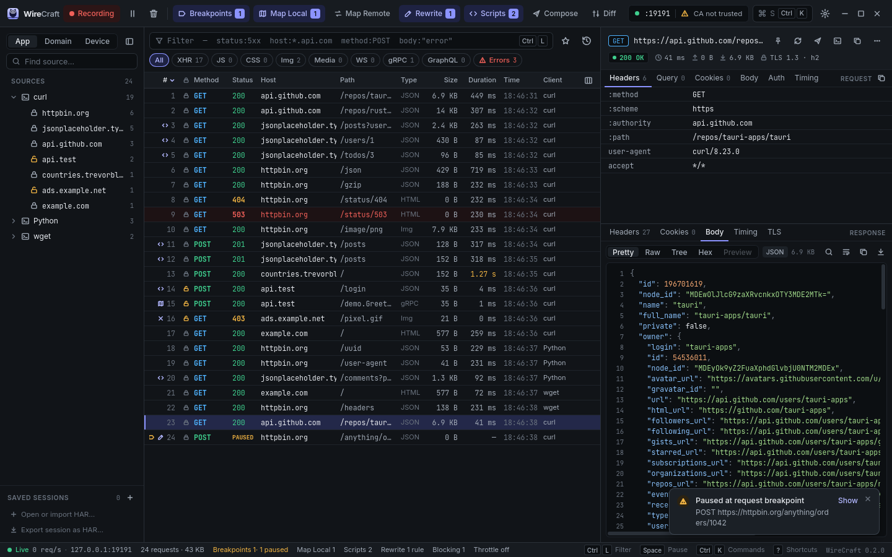
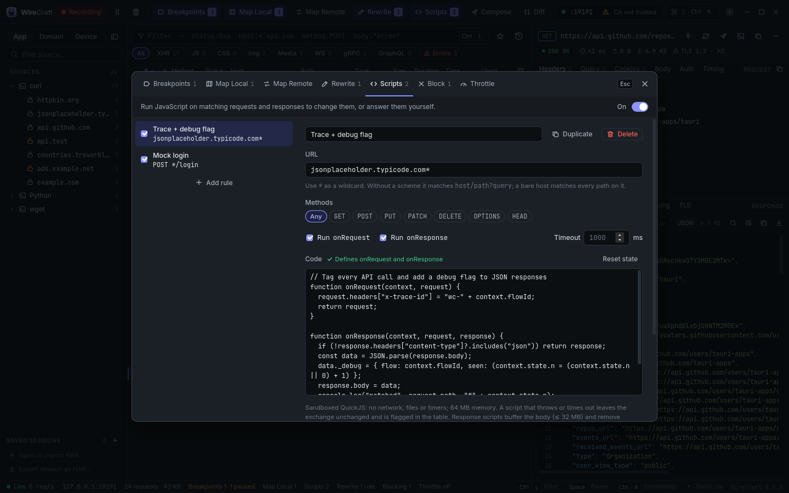
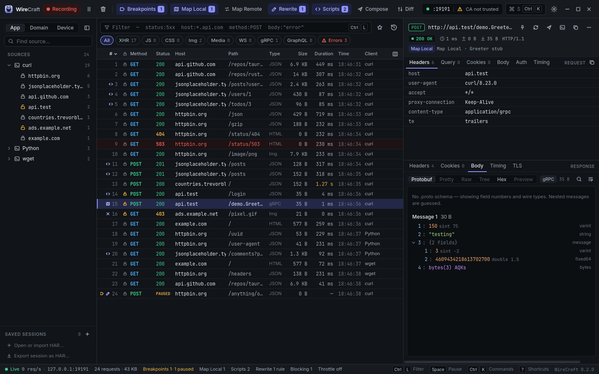
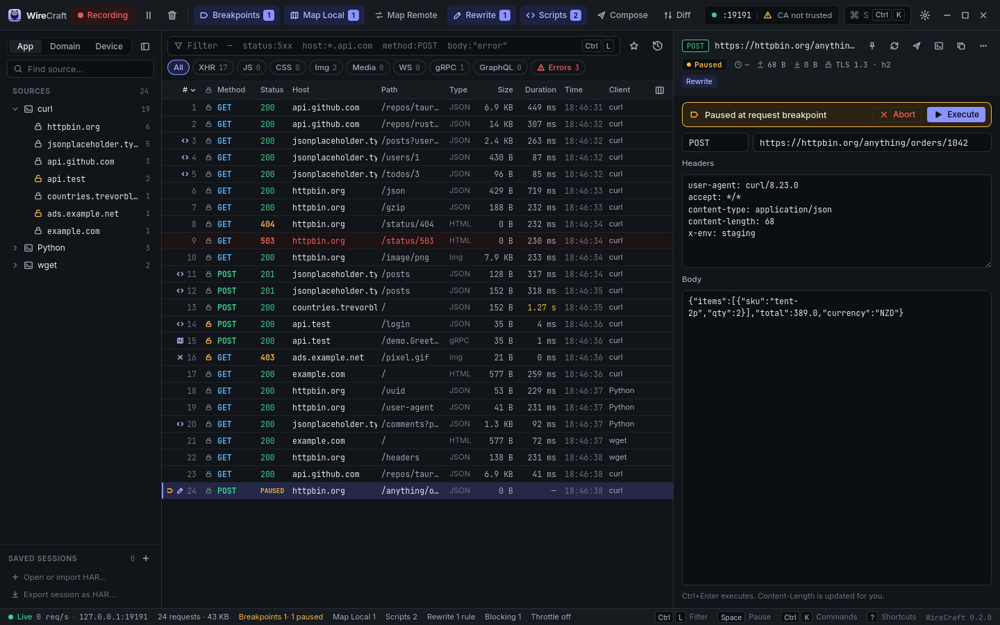
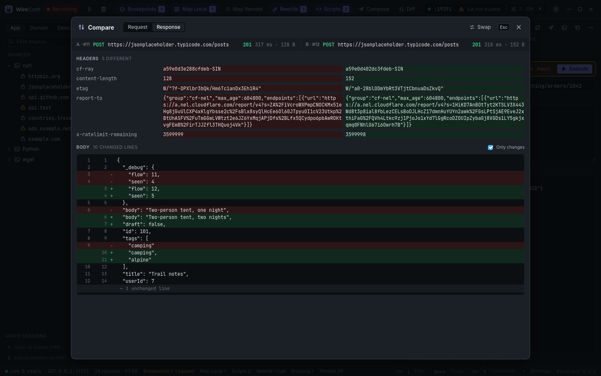
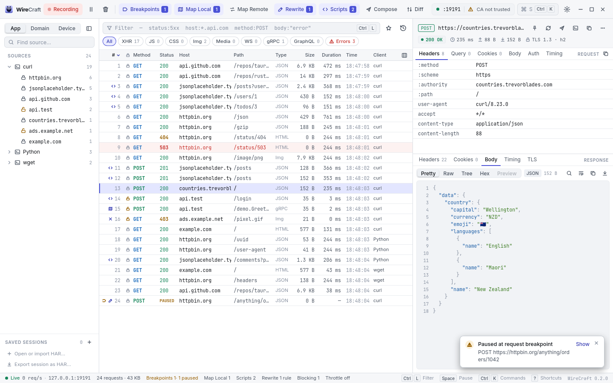
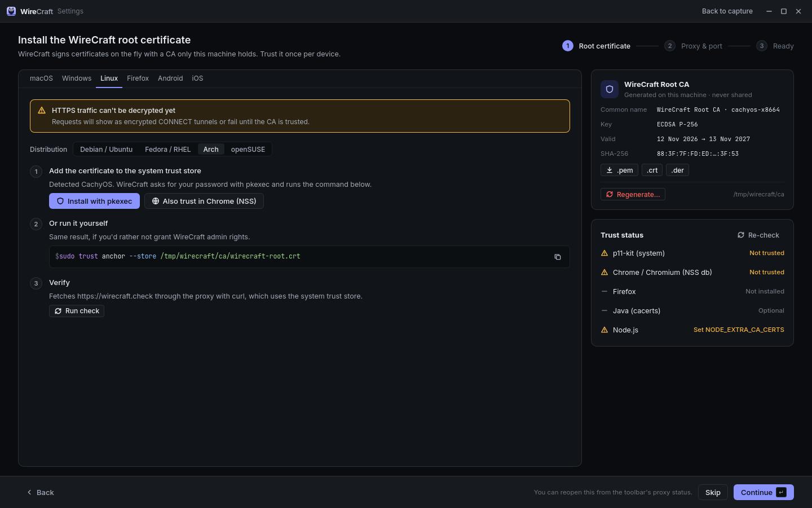

<p align="center">
  
</p>

<h1 align="center">WireCraft</h1>

<p align="center">
  <b>See every request your apps make: a native HTTPS debugging proxy, open source and built in Rust.</b><br>
  Capture, inspect, rewrite, mock and replay HTTP/1.1, HTTP/2, WebSocket and gRPC traffic<br>
  from desktop apps, browsers, terminals and phones. Everything stays on your machine.
</p>

<p align="center">
  
  
  
  
  
</p>

<p align="center">
  <a href="https://github.com/tanmaysinghx/xwire/releases"><b>Download</b></a> ·
  <a href="#a-look-around">A look around</a> ·
  <a href="#features">Features</a> ·
  <a href="#scripts">Scripts</a> ·
  <a href="#under-the-hood">Under the hood</a> ·
  <a href="#get-started">Get started</a> ·
  <a href="#releases">Releases</a>
</p>

<br>

<p align="center">
  
  <br><sub><b>The workspace</b>: traffic grouped by app and host, the request table and the inspector · real requests from curl, Python and wget</sub>
</p>

<br>

<table>
  <tr>
    <td width="25%" valign="top">
      <h3>🔍 See everything</h3>
      HTTPS decrypted with a root certificate generated on your machine. HTTP/1.1, HTTP/2, WebSocket messages, gRPC and protobuf, with the app that sent each request.
    </td>
    <td width="25%" valign="top">
      <h3>🛠 Change anything</h3>
      Breakpoints, Map Local, Map Remote, Rewrite, Block and Throttle, plus JavaScript scripts that edit requests and responses or answer them outright.
    </td>
    <td width="25%" valign="top">
      <h3>⚡ Native and fast</h3>
      A Rust proxy core (hyper, rustls) that streams bodies straight through, and a virtualized table built to hold up to 200,000 requests.
    </td>
    <td width="25%" valign="top">
      <h3>🔒 Local and private</h3>
      No account and no telemetry. Captured traffic never leaves your computer; sessions are plain HAR files on your own disk.
    </td>
  </tr>
</table>

<br>

## A look around

<table>
<tr>
<td width="50%" valign="top">
  
  <p align="center"><sub><b>Scripts</b>: sandboxed JavaScript on matching requests and responses, checked as you type</sub></p>
</td>
<td width="50%" valign="top">
  
  <p align="center"><sub><b>gRPC and protobuf</b>: frames, compression and fields decoded without a .proto file</sub></p>
</td>
</tr>
<tr>
<td width="50%" valign="top">
  
  <p align="center"><sub><b>Breakpoints</b>: hold a request or response, edit it, then execute or abort</sub></p>
</td>
<td width="50%" valign="top">
  
  <p align="center"><sub><b>Compare</b>: headers and bodies of two exchanges, line by line</sub></p>
</td>
</tr>
<tr>
<td width="50%" valign="top">
  
  <p align="center"><sub><b>Light theme</b>: every screen in both themes</sub></p>
</td>
<td width="50%" valign="top">
  
  <p align="center"><sub><b>Onboarding</b>: trust the root certificate on every platform, and check it worked</sub></p>
</td>
</tr>
</table>

## Features

<table>
  <tr>
    <td width="50%" valign="top">
      <h3>Capture</h3>
      An HTTP proxy and a SOCKS5 proxy on the same port. HTTPS is intercepted with per-host certificates minted from your own root CA (by SNI, so IP-only clients work too), or passed through untouched for hosts you choose; certificate pinning and rejected handshakes show up as their own rows. HTTP/1.1 and HTTP/2 on both sides, WebSocket messages, gzip / deflate / brotli / zstd bodies decoded, HTTP/2 trailers kept. The client process is identified on Linux, so traffic groups by app as well as by domain and device.
    </td>
    <td width="50%" valign="top">
      <h3>Inspect</h3>
      Headers, query, cookies, bodies (pretty, raw, JSON tree, hex, image and HTML preview), auth with JWT decoding, timing and TLS details. A filter language (<code>status:5xx host:*.api.com method:POST body:"error"</code>) with autocomplete, saved filters and quick chips for XHR, JS, CSS, images, media, WebSocket, gRPC, GraphQL and errors; full-text search through bodies.
    </td>
  </tr>
  <tr>
    <td width="50%" valign="top">
      <h3>Rewrite and mock</h3>
      <b>Map Local</b> answers with a canned body or a file, <b>Map Remote</b> sends requests to another server, <b>Rewrite</b> sets, adds, removes or find-and-replaces (regex too) headers, query parameters, URLs, bodies and status codes, <b>Block</b> refuses hosts, and <b>Throttle</b> simulates 3G, Edge or any latency and bandwidth. Rules match by URL wildcard and method, switch on and off per tool, and are created from any row's menu.
    </td>
    <td width="50%" valign="top">
      <h3>Replay and compare</h3>
      Repeat any request, edit and resend it in Compose, or copy it as cURL, fetch, Python, Go, reqwest or HTTPie. Compare two exchanges side by side. Save sessions, export HAR, and import HAR files or Charles JSON sessions (<code>.chlsj</code>).
    </td>
  </tr>
</table>

## Scripts

A script is plain JavaScript that runs on every request it matches:

```js
function onRequest(context, request) {
  request.headers["x-trace-id"] = "wc-" + context.flowId;
  // or answer without contacting the server:
  // return { response: { status: 200, body: { mocked: true } } };
  return request;
}

function onResponse(context, request, response) {
  const data = JSON.parse(response.body);
  data.patched = true;
  response.body = data; // objects are sent as JSON
  return response;
}
```

Handlers may be `async`. `context.state` persists between runs, and `console.log` goes to the script console. Scripts run in an embedded QuickJS sandbox with no network, file or timer access, 64 MB of memory and a time limit (1 s by default). A script that throws or times out leaves the exchange unchanged and is flagged in the table.

## Under the hood

- **Rust core** (`crates/wirecraft-core`): the proxy on hyper and rustls, the certificate authority (ECDSA P-256 via rcgen), the flow store, the rules engine, the WebSocket parser, the gRPC decoder and the QuickJS script runtime.
- **Desktop app** (`src-tauri`, `src`): Tauri 2 with a Svelte 5 interface. The design system (colours, type, spacing, icons) is generated from the design source in [`design/`](design).
- **Streaming first:** bodies stream straight through to the client while a capped copy is kept for inspection; only rules that need the whole body (response rewrites, breakpoints, response scripts) buffer it, up to 32 MB.
- **System integration:** installs the root certificate into the OS trust store (p11-kit, update-ca-certificates, macOS keychain, Windows) and NSS databases for Chrome and Firefox, and switches the GNOME or KDE system proxy on and off, restoring it when WireCraft quits.
- **Headless:** `cargo run -p wirecraft-core --example headless -- 127.0.0.1:9090` runs the proxy without a window and prints each exchange; `WIRECRAFT_RULES=rules.json` loads rules.

## Get started

Download an installer for Linux (AppImage, `.deb`, `.rpm`), macOS or Windows from the [releases page](https://github.com/tanmaysinghx/xwire/releases), or build from source:

```sh
git clone https://github.com/tanmaysinghx/xwire
cd xwire
npm ci
npx tauri dev            # the desktop app, with hot reload
npx tauri build          # installers in target/release/bundle/
cargo test --workspace   # the test suite
cargo xtask ci           # clippy, tests, svelte-check and the frontend build, as CI runs them
```

On Linux you need the WebKitGTK development packages (`libwebkit2gtk-4.1-dev` on Debian and Ubuntu, `webkit2gtk-4.1` on Arch and Fedora). If the window stays blank under Wayland, start it with `WEBKIT_DISABLE_DMABUF_RENDERER=1`.

The first launch walks you through trusting the root certificate and choosing a port (9090 by default). Point an app at `http://127.0.0.1:9090` (or `socks5h://127.0.0.1:9090`), or let WireCraft set the system proxy:

```sh
curl -x http://127.0.0.1:9090 https://example.com
curl --socks5-hostname 127.0.0.1:9090 https://example.com
```

> [!IMPORTANT]
> **Status:** WireCraft is **alpha**. Capture, inspection and every rule tool work end to end and are covered by tests through the real proxy, but expect rough edges. Not yet supported: loading `.proto` schemas, SOCKS4 and SOCKS5 authentication, and reading Charles' binary `.chls` or Proxyman session files (export HAR or JSON from those apps instead). Please file issues.

## Releases

WireCraft follows [SemVer](https://semver.org); the version lives in one place (`[workspace.package]` in `Cargo.toml`) and `cargo xtask version set <x.y.z>` updates everything else.

| Channel | How | When |
|---|---|---|
| **Stable** | `vX.Y.Z` GitHub Releases with installers and `SHA256SUMS.txt` | minor releases every one to two weeks while pre-1.0; patch releases for fixes |
| **Release candidates** | `vX.Y.Z-rc.N`, marked pre-release | before releases that change the proxy core, certificates or settings |
| **Nightly dry run** | builds every platform from `main` at 01:40 UTC, nothing published | every night |

A release is cut by bumping the version on `main` and pushing `main` to the `release` branch; the workflow builds Linux, macOS and Windows installers into a draft release, which a maintainer checks and publishes. The details are in [`docs/releasing.md`](docs/releasing.md).

## Privacy

WireCraft has no account, no telemetry and no update check. It only contacts the servers your own apps ask it to reach. The root CA's private key is generated on your machine, stays in WireCraft's data folder (`~/.local/share/wirecraft/ca` on Linux) and is never uploaded; anyone holding it could intercept traffic from devices that trust it, so regenerate it (Onboarding ▸ Root certificate ▸ Regenerate) if it might have leaked, and remove the certificate from devices you no longer debug.

---

## License

WireCraft is licensed under the [MIT License](LICENSE). The app icon and screenshots in this repository were made for this project. WireCraft was called **xwire** before 0.2.0: existing settings, sessions and the root certificate are moved over automatically on first launch.
